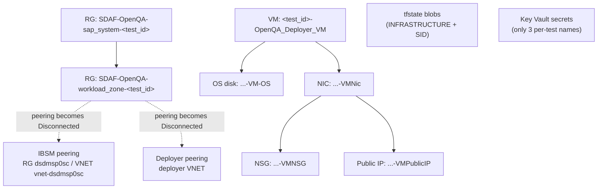

# SDAF Orphaned Resources Cleanup

Orphaned resource cleanup usually happens after a failure of standard cleanup routine which is a part of every OpenQA post-run and post-fail hook.  
This document defines the process for cleaning up orphaned SAP Deployment Automation Framework (SDAF) resources in Azure subscription 
sporadically left by openQA tests.  
Cleanup is postponed for 12 hours before deletion. This duration covers the longest-running test execution, plus a safety buffer.    

## 1. Resource naming patterns

Placeholders:
   - `<test_id>` : openQA test ID (123456)
   - `<ENV>` : environment (PRD, LAB)
   - `<region_long>` : Azure region (swedencentral, westeurope)
   - `<region_short>` : short region name (SECE, WEEU)
   - `<VNET>` : part of the deployer VNET name (DEP01, DEP00)

### Resource groups

| Resource | Pattern |
|---|---|
| SAP system RG | `SDAF-OpenQA-sap_system-<test_id>` |
| Workload zone RG | `SDAF-OpenQA-workload_zone-<test_id>` |
| Deployer RG | `OpenQA-SDAF-<ENV>-DEPLOYER-<region_long>` |
| Library RG | `OpenQA-SDAF-<ENV>-LIBRARY-<region_long>` |

### Deployer VM resources (in the permanent deployer RG)

| Resource | Pattern |
|---|---|
| VM | `<test_id>-OpenQA_Deployer_VM` |
| OS disk | `<test_id>-OpenQA_Deployer_VM-OS` |
| NIC | `<test_id>-OpenQA_Deployer_VMNic` |
| NSG | `<test_id>-OpenQA_Deployer_VMNSG` |
| Public IP | `<test_id>-OpenQA_Deployer_VMPublicIP` |

Attached resources cannot be deleted (deletion fails). NSG and Public IP are independent of each other.

### Key Vault secrets (Key Vault in the deployer RG)

| Secret | Pattern |
|--------|---------|
| Client ID | `<ENV>-<region_short>-<test_id>-client-id` |
| Client secret | `<ENV>-<region_short>-<test_id>-client-secret` |
| Subscription ID | `<ENV>-<region_short>-<test_id>-subscription_id` |

### Terraform state blobs (container `tfstate`, storage account `<unique name>` in the library RG)

| Blob | Pattern |
|------|---------|
| Infrastructure state | `<ENV>-<region_short>-<test_id>-INFRASTRUCTURE.terraform.tfstate` |
| SID state | `<ENV>-<region_short>-<test_id>-SID.terraform.tfstate` |

No deletion dependencies; may be deleted at any time. Blobs do not support tags.

### Orphaned network peerings

Deleting a workload_zone VNET leaves the remote-side peerings in state `Disconnected`.

| Type | Location | Rule |
|------|----------|------|
| IBSM peering | RG `dsdmsp0sc`, VNET `vnet-dsdmsp0sc` | Delete any `Disconnected` peering |
| Deployer peering | Deployer RG, VNET `<ENV>-<region_short>-<VNET>-vnet` | Delete only `Disconnected` peerings |

Reference names (not deletion criteria):

| Item | Pattern |
|------|---------|
| Workload zone VNET | `OpenQA-<test_id>` |
| Peering name | `<source_VNET>_to_<Destination_VNET>` |
| Deployer-side peering (derived) | `<ENV>-<region_short>-<VNET>-vnet_to_OpenQA-<test_id>` |
| IBSM peering | Not specified |

## 2. Deletion criteria

A resource is deleted only if it meets **all** criteria listed for its type. Name patterns are in section 1.

| Resource | Name matches pattern | Required tags | Older than 12 hours | State | Protected (section 4) |
|---|---|---|---|---|---|
| RG `sap_system` | `^SDAF-OpenQA-sap_system-[0-9]+$` | `deployment_id`, `openqa_created_date` | `openqa_created_date` tag | - | No, tag from OpenQA setting 'SDAF_NO_CLEANUP_TAG' undefined |
| RG `workload_zone` | `^SDAF-OpenQA-workload_zone-[0-9]+$` | `deployment_id`, `openqa_created_date` | `openqa_created_date` tag | RG `sap_system` of the same `<test_id>` is deleted | No, tag from OpenQA setting 'SDAF_NO_CLEANUP_TAG' undefined |
| Deployer VM | `^[0-9]+-OpenQA_Deployer_VM$` | `deployment_id`, `openqa_created_date` | `openqa_created_date` tag | - | No, tag from OpenQA setting 'SDAF_NO_CLEANUP_TAG' undefined |
| Deployer VM OS disk | `^[0-9]+-OpenQA_Deployer_VM-OS$` | `deployment_id`, `openqa_created_date` | `openqa_created_date` tag | Not attached to VM | No, tag from OpenQA setting 'SDAF_NO_CLEANUP_TAG' undefined |
| Deployer VM NIC | `^[0-9]+-OpenQA_Deployer_VMNic$` | `deployment_id`, `openqa_created_date` | `openqa_created_date` tag | Not attached to VM | No, tag from OpenQA setting 'SDAF_NO_CLEANUP_TAG' undefined |
| Deployer VM NSG | `^[0-9]+-OpenQA_Deployer_VMNSG$` | `deployment_id`, `openqa_created_date` | `openqa_created_date` tag | Not attached to NIC | No, tag from OpenQA setting 'SDAF_NO_CLEANUP_TAG' undefined |
| Deployer VM Public IP | `^[0-9]+-OpenQA_Deployer_VMPublicIP$` | `deployment_id`, `openqa_created_date` | `openqa_created_date` tag | Not attached to NIC | No, tag from OpenQA setting 'SDAF_NO_CLEANUP_TAG' undefined |
| Key Vault secrets | `^[A-Z]{3}-[A-Z]{4}-[0-9]+-(client-id\|client-secret\|subscription_id)$` | - | `attributes.created` | - | No, tagging not supported |
| tfstate blobs | `^[A-Z]{3}-[A-Z]{4}-[0-9]+-(INFRASTRUCTURE\|SID)\.terraform\.tfstate$` | - | `properties.creationTime` | - | No, tagging not supported |
| IBSM peering | No pattern check | - | No age check | `Disconnected`, in VNET `vnet-dsdmsp0sc` | No, tagging not supported |
| Deployer peering | No pattern check | - | No age check | `Disconnected`, in the deployer VNET | No, tagging not supported |

## 3. Deletion order

Steps per `<test_id>` (chains are independent):

1. Delete RG `SDAF-OpenQA-sap_system-<test_id>`.
2. Delete RG `SDAF-OpenQA-workload_zone-<test_id>` (only after step 1 completed).
3. Delete VM `<test_id>-OpenQA_Deployer_VM`.
4. Delete OS disk and NIC.
5. Delete NSG and Public IP (only after NIC is gone; any order).
6. Delete the 3 Key Vault secrets.
7. Delete the 2 tfstate blobs (any time).
8. IBSM peerings: delete every `Disconnected` peering in RG `dsdmsp0sc`, VNET `vnet-dsdmsp0sc`.
9. Deployer peerings: delete every `Disconnected` peering in the deployer VNET.

## 4. Protected resources

Never delete or touch:

- Deployer RG `OpenQA-SDAF-<ENV>-DEPLOYER-<region_long>` and everything in it that is not a per-test resource listed above, including:
  - the Key Vault (only the per-test secrets `<ENV>-<region_short>-<test_id>-(client-id|client-secret|subscription_id)` may be deleted),
  - the deployer VNET `<ENV>-<region_short>-<VNET>-vnet` (only `Disconnected` peerings may be deleted).
- Library RG `OpenQA-SDAF-<ENV>-LIBRARY-<region_long>` and everything in it, including:
  - the storage account `<unique name>`,
  - the `tfstate` container (only the per-test blobs `<ENV>-<region_short>-<test_id>-(INFRASTRUCTURE|SID).terraform.tfstate` may be deleted).
- IBSM RG `dsdmsp0sc` and its VNET `vnet-dsdmsp0sc` (only `Disconnected` peerings may be deleted).
- Any resource with tag from OpenQA setting 'SDAF_NO_CLEANUP_TAG'.
